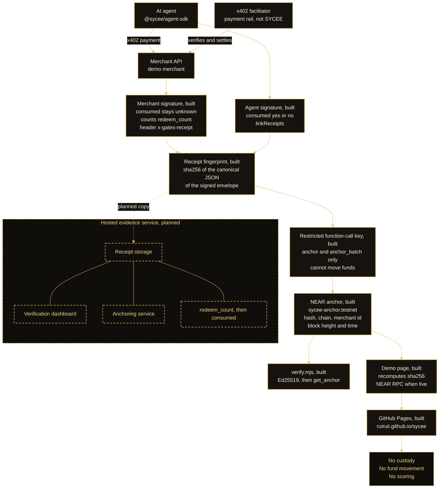
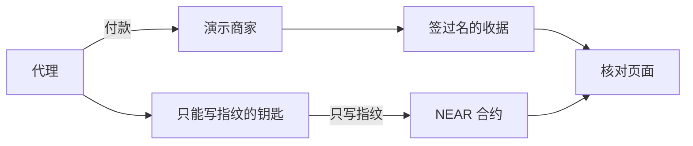
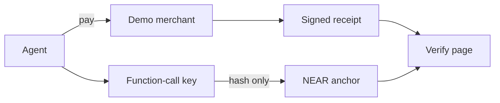

# SYCEE

[](https://github.com/ruiruii/sycee/actions/workflows/ci.yml)

SYCEE writes a signed receipt for an agent payment and fingerprints that receipt on NEAR, so anyone can verify what was bought.

## Try it

From a clean clone. Node.js 20 or newer, and [rustup](https://rustup.rs). The build installs Rust 1.86.0. No NEAR account and no secret. The demo anchors on a local sandbox. The last command only reads the public testnet contract.

```bash
git clone https://github.com/ruiruii/sycee.git
cd sycee
npm install
cd examples/near-anchor
npm install
bash scripts/build.sh
npm run demo:e2e
NEAR_CONTRACT_ID=sycee-anchor.testnet node scripts/verify.mjs --receipt fixtures/sample-receipt.json
```

You will see:

- `bash scripts/build.sh` ends with the wasm size `159146`.
- `npm run demo:e2e` prints `payment: SIMULATED`, `payment_note: mock facilitator, no Base Sepolia transfer, no funds moved`, `http_status: 200`, `receipt_hash: sha256:` and 64 hex characters, `chain: local NEAR sandbox`, `verify: ok true`, and `nearblocks: n/a`. Sandbox log lines may appear above that summary. The summary starts at `SYCEE e2e`.
- The verify command prints JSON with `"ok": true` and `sha256:f296fd15aee336c3d877dab40eec7a6e64f68923d4002807a2433866ab69cf03`.

Offline, open [examples/near-anchor/demo/index.html](examples/near-anchor/demo/index.html) and leave「离线示例」checked. The page recomputes `sha256:f296fd15aee336c3d877dab40eec7a6e64f68923d4002807a2433866ab69cf03` and matches the fingerprint written into the file. That check does not use the network.

- Live demo: [https://ruiruii.github.io/sycee/](https://ruiruii.github.io/sycee/)
- Demo post: [https://x.com/aking_z/status/2121175201778143394](https://x.com/aking_z/status/2121175201778143394)
- Video: [https://x.com/aking_z/status/2121175474265313681](https://x.com/aking_z/status/2121175474265313681)

Recorded testnet receipt (`tx` is the full nearblocks URL): [open it](https://ruiruii.github.io/sycee/?hash=sha256:618a391577ebd1e6a94430f05947e74c84a7d59523034ed28851b712a40ead81&offline=0&tx=https%3A%2F%2Ftestnet.nearblocks.io%2Ftxns%2F6TyCsHwSkwKshGgWGDJPFqrW2WLqrBnpvw3Amy4ppxTo).

## Architecture

An agent pays a merchant over x402. The merchant middleware and the agent SDK each sign a receipt. SYCEE fingerprints that signed receipt, and a restricted key anchors the fingerprint on NEAR. Anyone can check it. Dashed boxes are the hosted evidence service. That service is proposed and is not built in this repository.



[High-res diagram for slides](docs/architecture.svg) · [PNG](docs/architecture.png) · [Component notes](docs/ARCHITECTURE.md)

Solid outlines are in this repository today. The x402 facilitator is the payment rail: the demo calls it, and SYCEE does not take custody or move funds. Dashed outlines are planned.

## Why this fits the tracks

**AI Security & Defense.** The agent holds a restricted NEAR function-call key that can call only `anchor` and `anchor_batch`. A leaked agent key cannot move funds, add keys, or transfer. After the block above, from `examples/near-anchor`:

```bash
cd "$(git rev-parse --show-toplevel)/examples/near-anchor"
npm run demo:security
```

You see `key: function-call`, `methods: anchor,anchor_batch`, `deposit: not allowed`, `anchor_with_limited_key: ok`, `transfer NEAR: rejected`, `add key: rejected`, `call add_anchorer: rejected`, `attached deposit: rejected`, and `duplicate anchor: rejected`. A `Failure` line in the sandbox log is a rejected call. The summary still says `rejected`, and the command exits 0. This run stays on the local sandbox and needs no key.

**Agent Economy.** Agents pay for APIs and data over x402. The merchant signs a receipt for what was bought. The NEAR anchor is the public fingerprint of that receipt, so anyone can check it later without holding the payment.

**Real-World Money.** A merchant paid by an agent gets a verifiable receipt and a public fingerprint to keep as evidence of that payment. The receipt holds hashes and a signature. SYCEE does not invoice, hold, or move the merchant's funds.

## Sustainability

The open-source core in this repository stays free under Apache-2.0. The paid layer is a hosted evidence service: receipt storage, a verification dashboard, and anchoring. It keeps copies of receipts that are already signed. It does not take custody and it does not move funds. The service is in pilot with partners. See [Hosted evidence service](#hosted-evidence-service-proposed-in-pilot).

---

演示页面（打开就能看，不需要钱包）：[https://ruiruii.github.io/sycee/](https://ruiruii.github.io/sycee/)（也有本地文件 [examples/near-anchor/demo/index.html](examples/near-anchor/demo/index.html)）。

直接核对测试网上那笔模拟付款（`tx` 必须是完整的 nearblocks 网址，页面不认单独的交易号）：[https://ruiruii.github.io/sycee/?hash=sha256:618a391577ebd1e6a94430f05947e74c84a7d59523034ed28851b712a40ead81&offline=0&tx=https%3A%2F%2Ftestnet.nearblocks.io%2Ftxns%2F6TyCsHwSkwKshGgWGDJPFqrW2WLqrBnpvw3Amy4ppxTo](https://ruiruii.github.io/sycee/?hash=sha256:618a391577ebd1e6a94430f05947e74c84a7d59523034ed28851b712a40ead81&offline=0&tx=https%3A%2F%2Ftestnet.nearblocks.io%2Ftxns%2F6TyCsHwSkwKshGgWGDJPFqrW2WLqrBnpvw3Amy4ppxTo)。线上页面已经从 main 部署，并且会读取 `hash`、`offline` 和完整的 nearblocks `tx`。

## 我们解决什么

机器帮人付钱（agent payment）之后，旁人怎么确认那张收据没被改过。我们要的是一张能核对的收据（verifiable receipt）。演示商家在 Base Sepolia 上卖一个 0.001 美元的测试接口并签名收据。我们不给人打分，不保管钱，也不转账。

## 用了什么技术

收据仍在 Base Sepolia 产生。我们只把收据的指纹记到 NEAR 测试网，这就是跨链留痕（cross-chain anchoring）。指纹算法和 SYCEE 自己的一样。合约里只有指纹、来源链、商家公开地址、区块高度和时间。没有付款原文。测试网合约账号是 `sycee-anchor.testnet`（主人也是这个账号，写入名单是空的）。部署交易：[J14QkoAmZmtNeFrUcjb5BwN1WjhoN4L7QwiQ9YF5zq3h](https://testnet.nearblocks.io/txns/J14QkoAmZmtNeFrUcjb5BwN1WjhoN4L7QwiQ9YF5zq3h)。来自提交 `01b4e419`，wasm 159146 字节，sha256 `c027e046864760b51848501cec91c5c0b4e738d6dc94de86ce63d3d0ae98a236`。

## 怎么验证

1. 打开上面的演示页。里面已经放了一张示例收据。勾着「离线示例」，它会算出 `sha256:f296fd15aee336c3d877dab40eec7a6e64f68923d4002807a2433866ab69cf03`，并和页内写死的指纹对照。这一步不连网。
2. 开发者在 `examples/near-anchor/` 跑 `bash scripts/build.sh` 和 `npm test`。合约 wasm 159146 字节。Rust 测试 6 个、Node 单元测试 16 个、本地 NEAR 沙箱测试 3 个，都已通过。沙箱覆盖写入、重复拒绝、外人拒绝、查询、核对脚本、端到端演示和受限钥匙演示。
3. 示例收据 `examples/near-anchor/fixtures/sample-receipt.json` 已经写在 `sycee-anchor.testnet`。指纹 `sha256:f296fd15aee336c3d877dab40eec7a6e64f68923d4002807a2433866ab69cf03`，来源链 `eip155:84532`，商家 `sycee:demo-merchant`，区块 277456711。锚定交易：[9WbMG7rgCiX7TNhnhZdSwGvz2xv82HX3oCgbVCdQHxzJ](https://testnet.nearblocks.io/txns/9WbMG7rgCiX7TNhnhZdSwGvz2xv82HX3oCgbVCdQHxzJ)。`verify.mjs` 返回成功。这是核对过的结果，不是计划。

## 这次黑客松做了什么

SYCEE 的规格和签名代码在 2026-10-19 之前就有了。那天是 NEAR 黑客松公布的日子。那天之前最后一次提交是 [`f1af69d`](https://github.com/ruiruii/sycee/commit/f1af69de1f461d9d656f598473042187e9118db1)（2026-10-12）。

这次新做的是 NEAR 这一段：`examples/near-anchor/` 里的合约、演示页、端到端演示和受限钥匙演示。对照从那次旧提交到 main：

https://github.com/ruiruii/sycee/compare/f1af69de1f461d9d656f598473042187e9118db1...main

这个对照里也有 10 月 19 日之后合进 main 的其他改动，包括 Base Sepolia 演示商家。NEAR 合约本身是后来加的。标签 `pre-hackathon` 和 `hackathon-submission` 由主人自己加，这里不打标签。

## 用了哪些现成的东西，哪些是 AI 写的

- `near-sdk` 5.7.1：写合约
- `near-workspaces` 和里面的 `near-sandbox`（nearcore 2.6.2）：本地沙箱，默认演示和测试用它
- `near-api-js` 5：脚本签名、发交易
- `near-cli-rs`：人自己部署时用，不是 npm 依赖
- binaryen 的 `wasm-opt`：把编译结果收成沙箱能加载的格式
- `@sycee/core` 和演示商家：10 月 19 日之前或之后已经在 main 上的 SYCEE 代码，算原有基线

`examples/near-anchor/` 里的大部分代码是用 Cursor 的 AI 编程助手写的，再由团队看过。

## 三步试一下

在仓库根目录做。每一步做完，你应该看到右边这些字。

1. 安装并编译。需要 Node.js 20 或更新版本，以及 rustup。`scripts/build.sh` 会安装 Rust 1.86.0。下面每一段命令都从仓库根目录算起，新开一个终端也能跑。

```bash
cd "$(git rev-parse --show-toplevel)"
npm install
cd examples/near-anchor
npm install
bash scripts/build.sh
```

你看到：最后一行是 wasm 的字节数，`159146`。

2. 跑默认的端到端演示。这是模拟付款，没有真的转账，也不需要钥匙。

```bash
cd "$(git rev-parse --show-toplevel)/examples/near-anchor"
npm run demo:e2e
```

你看到这些行：`payment: SIMULATED`，`payment_note: mock facilitator, no Base Sepolia transfer, no funds moved`，`http_status: 200`，`receipt_hash: sha256:` 后面 64 位，`chain: local NEAR sandbox`，`verify: ok true`，`nearblocks: n/a`。

3. 用已经部署的测试网合约核对仓库里的示例收据。这一步只读，不花钱，不需要钥匙。

```bash
cd "$(git rev-parse --show-toplevel)/examples/near-anchor"
NEAR_CONTRACT_ID=sycee-anchor.testnet node scripts/verify.mjs --receipt fixtures/sample-receipt.json
```

你看到 JSON 里 `"ok": true`，以及 `sha256:f296fd15aee336c3d877dab40eec7a6e64f68923d4002807a2433866ab69cf03`。

演示页可以贴第 2 步打印的整段，或只贴 `receipt_hash` 那一行。地址可以带 `?hash=sha256:...&tx=https://testnet.nearblocks.io/txns/...&offline=0`。取消「离线示例」后，它会去问 `sycee-anchor.testnet`。沙箱里新算出来的指纹不在测试网上，这是正常的。示例收据那条在测试网上，区块 277456711。

可选。下面这一步需要你自己已经有的 NEAR 账号和钥匙。上面的演示不需要。钥匙在 `~/.near-credentials/testnet/sycee-anchor.testnet.json` 或 `NEAR_PRIVATE_KEY`，脚本不打印钥匙：

```bash
cd "$(git rev-parse --show-toplevel)/examples/near-anchor"
NEAR_ACCOUNT_ID=sycee-anchor.testnet NEAR_CONTRACT_ID=sycee-anchor.testnet npm run demo:e2e -- --testnet
```

你看到：`payment: SIMULATED`，`chain: NEAR testnet`，`verify: ok true`，`nearblocks: https://testnet.nearblocks.io/txns/` 开头的链接。演示页地址会带上 `&tx=`。

已经在测试网跑通一次。交易 [6TyCsHwSkwKshGgWGDJPFqrW2WLqrBnpvw3Amy4ppxTo](https://testnet.nearblocks.io/txns/6TyCsHwSkwKshGgWGDJPFqrW2WLqrBnpvw3Amy4ppxTo)，收据指纹以 `sha256:618a3915` 开头（完整 64 位在这笔交易里）。付款仍是模拟的，没有在 Base 上转账。

安全演示，默认也在本地沙箱，不需要钥匙：

```bash
cd "$(git rev-parse --show-toplevel)/examples/near-anchor"
npm run demo:security
```

你看到：`key: function-call`，`methods: anchor,anchor_batch`，`deposit: not allowed`，`anchor_with_limited_key: ok`，`transfer NEAR: rejected`，`add key: rejected`，`call add_anchorer: rejected`，`attached deposit: rejected`，`duplicate anchor: rejected`。

这把钥匙只能调用这个合约的 `anchor` 和 `anchor_batch`，并且只能用额度里的 gas。它不能转 NEAR，不能附带存款，不能再加钥匙，也不能调别的方法。合约自己还拒绝重复指纹、拒绝名单外的账号、拒绝别人转进来的 NEAR。

可选。要在测试网上看同一件事，需要你自己已经有的 NEAR 账号。这一步会给 `sycee-anchor.testnet` 加一把受限钥匙，只花测试网的手续费：

```bash
cd "$(git rev-parse --show-toplevel)/examples/near-anchor"
NEAR_ACCOUNT_ID=sycee-anchor.testnet NEAR_CONTRACT_ID=sycee-anchor.testnet npm run demo:security -- --testnet
```

已经在测试网跑通。受限公钥 `ed25519:7G1L5eMc5pKCJcVNbHvv68j1THA6bxc9QDFg7sFN4Qjy`，加钥匙的交易是 [HpZaM37gDbngx7skC1vjk81QFkjb7Yv2jLHN7GGWSLnh](https://testnet.nearblocks.io/txns/HpZaM37gDbngx7skC1vjk81QFkjb7Yv2jLHN7GGWSLnh)，用这把钥匙写入的交易是 [9u6vfDWwuMdUcyVb3LXDUuotbdQBF68EmbX7Z6oRM8r6](https://testnet.nearblocks.io/txns/9u6vfDWwuMdUcyVb3LXDUuotbdQBF68EmbX7Z6oRM8r6)，重复写入被合约拒绝的交易是 [234ghPupTc158iY6osT53vBTML823BrGYLgdeNg4dPM6](https://testnet.nearblocks.io/txns/234ghPupTc158iY6osT53vBTML823BrGYLgdeNg4dPM6)。转账、再加一把钥匙、调用 `add_anchorer` 在钥匙校验时就被拒绝，区块浏览器上不一定看得到这三笔失败。



| 评审看什么 | 我们做了什么 | 证据 |
|---|---|---|
| 技术能不能跑 | 合约、本地沙箱、端到端命令 | `npm run demo:e2e`，`.github/workflows/near-anchor.yml` |
| 设计 | 只存指纹，不评分，不碰钱 | `examples/near-anchor/contract/src/lib.rs` |
| 有没有用 | 测试网上能查到示例收据 | [锚定交易](https://testnet.nearblocks.io/txns/9WbMG7rgCiX7TNhnhZdSwGvz2xv82HX3oCgbVCdQHxzJ) |
| 是不是自己的东西 | 旧代码在 10 月 19 日前；NEAR 这段是新的 | [对照](https://github.com/ruiruii/sycee/compare/f1af69de1f461d9d656f598473042187e9118db1...main) |
| 能不能接着用 | 不托管资金；代理钥匙权限被收窄 | `npm run demo:security` |

完整中文说明：[examples/near-anchor/SUBMISSION.zh.md](examples/near-anchor/SUBMISSION.zh.md)。主人清单：[examples/near-anchor/提交清单.md](examples/near-anchor/提交清单.md)。

---

A page you can open, with no wallet: [https://ruiruii.github.io/sycee/](https://ruiruii.github.io/sycee/). The same file is [examples/near-anchor/demo/index.html](examples/near-anchor/demo/index.html).

Live check of the recorded testnet receipt. The `tx` parameter must be the full nearblocks URL:

[https://ruiruii.github.io/sycee/?hash=sha256:618a391577ebd1e6a94430f05947e74c84a7d59523034ed28851b712a40ead81&offline=0&tx=https%3A%2F%2Ftestnet.nearblocks.io%2Ftxns%2F6TyCsHwSkwKshGgWGDJPFqrW2WLqrBnpvw3Amy4ppxTo](https://ruiruii.github.io/sycee/?hash=sha256:618a391577ebd1e6a94430f05947e74c84a7d59523034ed28851b712a40ead81&offline=0&tx=https%3A%2F%2Ftestnet.nearblocks.io%2Ftxns%2F6TyCsHwSkwKshGgWGDJPFqrW2WLqrBnpvw3Amy4ppxTo)

The site that is live now was deployed from main. It reads `hash`, `offline`, and a full nearblocks `tx` URL.

This is the English text of [examples/near-anchor/SUBMISSION.zh.md](examples/near-anchor/SUBMISSION.zh.md). The same file is [examples/near-anchor/SUBMISSION.en.md](examples/near-anchor/SUBMISSION.en.md).

## Problem

An agent pays for a call on a person's behalf (agent payment). After the payment, how can someone else tell that the receipt was not edited?

SYCEE already issues a verifiable receipt. The demo merchant, on Base Sepolia, sells one test call, `GET /v1/base/tip`, for 0.001 test USDC. When the payment is accepted, the merchant signs a receipt. The receipt holds hashes and a signature. It does not hold the payment itself.

What was missing is a public time record: this receipt's fingerprint was written down at a known moment. This project does not score anyone, does not hold funds, and does not move funds.

## Solution

The receipt is still produced by the demo merchant on Base Sepolia. This project copies the receipt's fingerprint onto NEAR. That copy is the cross-chain anchoring step: one chain produces the receipt, the other stamps the fingerprint with a block time.

The fingerprint uses the same algorithm SYCEE already uses. The receipt is turned into one canonical JSON text, then SHA-256. For the sample receipt in this repo, that value is `sha256:f296fd15aee336c3d877dab40eec7a6e64f68923d4002807a2433866ab69cf03`.

That sample is not a payment that happened. The demo page recomputes it with the same algorithm and can match this string with no network.

The contract stores the fingerprint, the source chain (for example `eip155:84532`), the merchant's public payTo address, the block height, the time, and which account wrote it. It does not store the receipt body, the payment proof, or personal data.

Who may write is fixed at deploy. Everyone else can only read. The same fingerprint cannot be written twice.

## What we built on NEAR

The contract is in `examples/near-anchor/contract/`. It does not accept NEAR and it does not send NEAR. In plain language the methods are:

- `new`: at deploy, sets the owner and any other accounts allowed to write. Called once.
- `anchor`: writes one receipt fingerprint. A repeat is rejected. An account that is not on the list is rejected.
- `anchor_batch`: writes up to 32 fingerprints and computes one combined fingerprint (a Merkle root). The contract computes that root. The caller does not get to invent it.
- `get_anchor`: looks up one fingerprint. Returns empty when it was never written.
- `is_anchored`: whether that fingerprint is stored.
- `get_batch`: looks up one combined fingerprint.
- `verify_inclusion`: given one fingerprint and a short proof, checks that it belongs to that combined fingerprint and that this contract stored the batch.
- `add_anchorer` / `remove_anchorer`: the owner adds or removes a writer. The owner cannot be removed.
- `get_owner` / `is_anchorer`: read the owner and the writer list. Anyone can read.

Each write emits a public log in the NEP-297 shape. The log is fingerprints and labels only.

Checking happens in two places. The browser page only recomputes the fingerprint. The Node script `examples/near-anchor/scripts/verify.mjs` also checks the SYCEE signature, then compares the fingerprint on chain. The chain does not check the signature, does not decide whether the payment succeeded, and does not decide whether the buyer used the result.

## Results

These ran on this machine. They are not a plan.

- The contract builds. `bash examples/near-anchor/scripts/build.sh` writes a wasm of 159146 bytes (`examples/near-anchor/out/sycee_anchor.wasm`).
- 6 Rust unit tests passed (`cargo +1.100.0 test`): write, duplicate rejected, stranger rejected, attached deposit rejected, the owner allows another writer, and the batch fingerprint matches the off-chain check.
- 16 Node unit tests passed: the fingerprint matches `@sycee/core`, the combined fingerprint, the demo page's algorithm, and the deploy script's refusal of mainnet.
- 3 local NEAR sandbox tests passed. They cover the contract sandbox (write, duplicate rejected, stranger rejected, a missing fingerprint reads back empty, attached NEAR rejected, the public log, a batch root equal to the JavaScript root, `verify_inclusion`, and `scripts/verify.mjs` against that local chain), the end-to-end demo, and the restricted-key demo.
- The demo page opens with a sample receipt filled in. With "离线示例" checked, it computes `sha256:f296fd15aee336c3d877dab40eec7a6e64f68923d4002807a2433866ab69cf03` and shows that this matches the fingerprint written into the page. That step does not contact testnet.
- The same sample receipt is on NEAR testnet. Contract account `sycee-anchor.testnet` (owner `sycee-anchor.testnet`, anchorers `[]`), deployed from commit `01b4e419`, wasm 159146 bytes, sha256 `c027e046864760b51848501cec91c5c0b4e738d6dc94de86ce63d3d0ae98a236`. Deploy transaction: [J14QkoAmZmtNeFrUcjb5BwN1WjhoN4L7QwiQ9YF5zq3h](https://testnet.nearblocks.io/txns/J14QkoAmZmtNeFrUcjb5BwN1WjhoN4L7QwiQ9YF5zq3h). The anchor is hash `sha256:f296fd15aee336c3d877dab40eec7a6e64f68923d4002807a2433866ab69cf03`, source chain `eip155:84532`, merchant id `sycee:demo-merchant`, block 277456711. Anchor transaction: [9WbMG7rgCiX7TNhnhZdSwGvz2xv82HX3oCgbVCdQHxzJ](https://testnet.nearblocks.io/txns/9WbMG7rgCiX7TNhnhZdSwGvz2xv82HX3oCgbVCdQHxzJ). `verify.mjs` returned ok.

## What was built during the hackathon

SYCEE's specification and signing code already existed before 2026-10-19, the day the NEAR hackathon was announced. The last commit before that day is [`f1af69d`](https://github.com/ruiruii/sycee/commit/f1af69de1f461d9d656f598473042187e9118db1) (2026-10-12).

The new work is the NEAR piece in `examples/near-anchor/`: the contract, the demo page, the end-to-end demo, and the restricted-key demo. Compare that baseline to `main`:

https://github.com/ruiruii/sycee/compare/f1af69de1f461d9d656f598473042187e9118db1...main

That diff also contains other SYCEE commits that landed on main after 19 October, including the Base Sepolia demo merchant. The NEAR contract itself starts on this line of work. The owner will add the tags `pre-hackathon` and `hackathon-submission`. This repository does not create those tags.

## Libraries, templates and AI-generated code

- `near-sdk` 5.7.1: the contract
- `near-workspaces` and its `near-sandbox` (nearcore 2.6.2): local chain for tests and the default demos
- `near-api-js` 5: signing and sending from the scripts
- `near-cli-rs`: what a person runs to deploy; not an npm dependency
- `wasm-opt` from binaryen: rewrites the wasm so the sandbox can load it
- `@sycee/core` and the demo merchant: existing SYCEE code, treated as the baseline

Most of `examples/near-anchor/` was written with Cursor AI coding agents and reviewed by the team.

## 3-step try it

From the repository root. Each step says what you should see.

1. Install and build.

Node.js 20 or newer, and rustup. `scripts/build.sh` installs Rust 1.86.0. Each block below starts from the clone root, so it still works in a new shell.

```bash
cd "$(git rev-parse --show-toplevel)"
npm install
cd examples/near-anchor
npm install
bash scripts/build.sh
```

You see the wasm size on the last line: `159146`.

2. Run the default end-to-end demo. The payment is simulated. No key and no transfer.

```bash
cd "$(git rev-parse --show-toplevel)/examples/near-anchor"
npm run demo:e2e
```

You see `payment: SIMULATED`, `payment_note: mock facilitator, no Base Sepolia transfer, no funds moved`, `http_status: 200`, `receipt_hash: sha256:` plus 64 hex characters, `chain: local NEAR sandbox`, `verify: ok true`, and `nearblocks: n/a`.

3. Check the sample receipt that is already on testnet. This is a read. It does not spend and does not need a key.

```bash
cd "$(git rev-parse --show-toplevel)/examples/near-anchor"
NEAR_CONTRACT_ID=sycee-anchor.testnet node scripts/verify.mjs --receipt fixtures/sample-receipt.json
```

You see JSON with `"ok": true` and `sha256:f296fd15aee336c3d877dab40eec7a6e64f68923d4002807a2433866ab69cf03`.

The demo page accepts the printed block, or only the `receipt_hash` line. A link can be `demo/index.html?hash=sha256:...&tx=https://testnet.nearblocks.io/txns/...&offline=0`. Uncheck "离线示例" to query `sycee-anchor.testnet`. A hash minted in the sandbox is not on testnet. The sample receipt is, at block 277456711.

Optional. Skip this unless you already have the NEAR account. The key is in `~/.near-credentials/testnet/sycee-anchor.testnet.json` or `NEAR_PRIVATE_KEY`. The script does not print it.

```bash
cd "$(git rev-parse --show-toplevel)/examples/near-anchor"
NEAR_ACCOUNT_ID=sycee-anchor.testnet NEAR_CONTRACT_ID=sycee-anchor.testnet npm run demo:e2e -- --testnet
```

You see `payment: SIMULATED`, `chain: NEAR testnet`, `verify: ok true`, and `nearblocks: https://testnet.nearblocks.io/txns/...`. The `demo_page` line includes `&tx=`.

One testnet run is already recorded. Transaction [6TyCsHwSkwKshGgWGDJPFqrW2WLqrBnpvw3Amy4ppxTo](https://testnet.nearblocks.io/txns/6TyCsHwSkwKshGgWGDJPFqrW2WLqrBnpvw3Amy4ppxTo). The receipt hash starts with `sha256:618a3915` (the full 64 hex digits are in that transaction). The payment was still simulated. No Base transfer.

Security demo, local sandbox, no key:

```bash
cd "$(git rev-parse --show-toplevel)/examples/near-anchor"
npm run demo:security
```

You see `key: function-call`, `methods: anchor,anchor_batch`, `deposit: not allowed`, `anchor_with_limited_key: ok`, `transfer NEAR: rejected`, `add key: rejected`, `call add_anchorer: rejected`, `attached deposit: rejected`, and `duplicate anchor: rejected`.

That key may call only `anchor` and `anchor_batch` on this contract, and may spend gas up to its allowance. It cannot transfer NEAR, attach a deposit, add a key, or call another method. The contract also rejects a duplicate hash, a caller who is not on the list, and an attached deposit.

Optional. Skip this unless you already have the NEAR account. It adds one restricted key to `sycee-anchor.testnet` and spends testnet gas only:

```bash
cd "$(git rev-parse --show-toplevel)/examples/near-anchor"
NEAR_ACCOUNT_ID=sycee-anchor.testnet NEAR_CONTRACT_ID=sycee-anchor.testnet npm run demo:security -- --testnet
```

One testnet run is already recorded. Restricted public key `ed25519:7G1L5eMc5pKCJcVNbHvv68j1THA6bxc9QDFg7sFN4Qjy`. The key was added in [HpZaM37gDbngx7skC1vjk81QFkjb7Yv2jLHN7GGWSLnh](https://testnet.nearblocks.io/txns/HpZaM37gDbngx7skC1vjk81QFkjb7Yv2jLHN7GGWSLnh). That key anchored a receipt in [9u6vfDWwuMdUcyVb3LXDUuotbdQBF68EmbX7Z6oRM8r6](https://testnet.nearblocks.io/txns/9u6vfDWwuMdUcyVb3LXDUuotbdQBF68EmbX7Z6oRM8r6). A second write of the same hash panicked in [234ghPupTc158iY6osT53vBTML823BrGYLgdeNg4dPM6](https://testnet.nearblocks.io/txns/234ghPupTc158iY6osT53vBTML823BrGYLgdeNg4dPM6). Transfer, adding another key, and calling `add_anchorer` were rejected when the access key was checked, so those three failures may not show up on an explorer.



| Judging area | What we did | Evidence |
|---|---|---|
| Technical implementation | Contract, sandbox, one command | `npm run demo:e2e`, `.github/workflows/near-anchor.yml` |
| Design | Hashes only. No score, no custody | `examples/near-anchor/contract/src/lib.rs` |
| Impact | The sample receipt is readable on testnet | [anchor tx](https://testnet.nearblocks.io/txns/9WbMG7rgCiX7TNhnhZdSwGvz2xv82HX3oCgbVCdQHxzJ) |
| Originality | Core predates 19 October; the NEAR piece is new | [compare](https://github.com/ruiruii/sycee/compare/f1af69de1f461d9d656f598473042187e9118db1...main) |
| Sustainability | No custody. The agent key cannot move funds | `npm run demo:security` |

The owner posted these. Nothing is posted from here.

- Demo video: [https://x.com/aking_z/status/2121175474265313681](https://x.com/aking_z/status/2121175474265313681) (2-min, posted as a reply under the demo post).
- Demo post on X: [https://x.com/aking_z/status/2121175201778143394](https://x.com/aking_z/status/2121175201778143394).

Still the owner's, not done here:

- Mainnet payout account: `locallemon5213.near`. The owner created it and it was verified on mainnet. Nothing in this repository is deployed to mainnet, and nothing here moves funds.
- Public demo URL: [https://ruiruii.github.io/sycee/](https://ruiruii.github.io/sycee/) (HTTP 200, deployed from main). The published page reads `hash`, `offline`, and a full nearblocks `tx` URL.

---

# SYCEE

[](https://github.com/ruiruii/sycee/actions/workflows/ci.yml)

> **We record. Others score.**  
> **记录消费与兑现实；不评分、不托管、不触碰资金。**

`SYCEE` is a protocol-agnostic semantic layer for machine payments. It answers
two questions that upstream protocols do not yet define:

1. **Was the paid result actually consumed by downstream context?**
2. **How many times was the same payment proof redeemed?**

Existing work (x402-receipts, Vauban IETF drafts, ERC-8183, VCAP, APOP/APASS)
focuses on **receipt format and delivery proof**: "Did the seller send the bytes?"
`SYCEE` focuses on **outcome semantics**: "Did the buyer use the bytes?"

This repository contains the specification, a reference implementation, a
zero-dependency conformance suite, and a proposal path to upstream standards.

---

## Name

This project was published as `gates-spec` through v0.1 and is now **SYCEE**,
at [`ruiruii/sycee`](https://github.com/ruiruii/sycee). The previous repository
name, [`ruiruii/gates-spec`](https://github.com/ruiruii/gates-spec), redirects
to a stub at
[`ruiruii/gates-spec-migrated`](https://github.com/ruiruii/gates-spec-migrated),
which points here. Receipts and packages under the old `gates-spec` identifiers
are not aliases of `sycee/v0.1`.

| was | is |
|-----|-----|
| `gates-spec/v0.1` (receipt `schema_version`) | `sycee/v0.1` |
| `@gates-spec/{core,middleware,agent-sdk,conformance,adapter-automaton,probe}` | `@sycee/{...}` |

Receipts carrying `gates-spec/v0.1` were signed under the old string and remain
valid **as signed artifacts**. Because the version string is one of the inputs
to a vector fingerprint, every conformance vector hash changed when it moved.
The twelve vectors were regenerated with the repository's own generator rather
than patched by hand, and the three rejection paths survived: schema-rejected,
signature-rejected, and semantic (`level: invalid`).

---

## One-line pitch

> "Others prove delivery; we prove consumption."
> （别人证明“送到了”；我们证明“被用了”。）

## Hosted evidence service (proposed, in pilot)

The packages in this repository are free and Apache-2.0. An optional hosted service would keep an independent, third-party copy of already-signed receipts (phase 1: `redeem_count` only; agent-signed `consumed` later). It is being developed with pilot partners; it is not a live product. We are offering a free two-week pilot in exchange for feedback. Pricing after the pilot is set with those partners; we are not publishing a price here. No scoring, no custody, no fund movement.

Contact: The SYCEE team · sycee.rachel@gmail.com

---

## Why this matters

| Layer | Question it answers | State of the art | What is missing |
|-------|--------------------|------------------|-----------------|
| x402, MPP, AP2, APOP | How does the agent pay? | Standards and SDKs exist | — |
| x402-receipts, Vauban | Did payment happen and did the seller deliver? | Production code, IETF drafts | Consumption evidence |
| ERC-8183, VCAP | Did an evaluator judge work complete? | Escrow / verdict layers | Non-custodial, non-scoring evidence |
| **SYCEE** | **Was the result consumed? How many redemptions?** | **This repo** | — |

An HTTP `200` means the response was delivered. It does **not** mean the agent:
- put the result in a prompt,
- passed it to another tool,
- stored it in working memory, or
- showed it to a user.

That gap is idle spend. It is also the gap where the same `payment_proof` can be
redeemed against multiple resources without anyone noticing. `SYCEE`
makes both observable.

---

## What is in this repo

```
SYCEE/
├── SPEC.md                    # normative specification v0.1
├── schema/vsr-v0.1.schema.json # JSON Schema for Verifiable Spend Receipts
├── conformance/vectors/        # signed conformance test vectors
├── packages/
│   ├── core/                   # canonical JSON, Ed25519 sign/verify, VSR builder
│   ├── middleware/             # merchant-side HTTP middleware (counts redemptions)
│   ├── agent-sdk/              # agent-runtime SDK (records consumption)
│   ├── conformance/            # test suite, validator, CLI
│   ├── adapter-automaton/      # binds a hash-chained attestation ledger (RW-001 origin)
│   └── probe/                  # evidence-layer CLI (probe/verify/batch, signed reports)
├── upstream/                   # ready-to-send proposals to x402-receipts, Vauban, ERC-8004
└── examples/                   # demos, including examples/near-anchor (NEAR testnet hash log)
```

All packages are **zero-dependency** and use Node native Ed25519 (`crypto`).

---

## Quick start

```bash
git clone https://github.com/ruiruii/sycee.git
cd sycee
npm install          # links the local workspaces, no external dependencies
npm test             # 160 tests across the packages and the demo merchant
npm run verify       # 12 signed conformance vectors, expectations enforced
npm run matrix       # same 12 verdicts as one page (conformance/vectors/matrix.svg)
npm run demo         # one payable server + one buyer, end to end
npm run demo:refusal # five attempts, one ledger, four claims checked offline
```

`npm run demo:refusal` is the other half of the record: four refused attempts and one
accepted one, every decision on one ledger, each refusal handed to the buyer as a signed
claim and verified offline — including the two things a claim must never be able to do
(claim a stronger evidence class than its reason allows, present an unsettled payment as
final). Specified in [`SPEC.md` §5.5](./SPEC.md) and
[`specs/extensions/refusal-row.md`](./specs/extensions/refusal-row.md).

`npm run demo` starts a server on a random local port, has a buyer pay twice
with the same proof, and prints what each side recorded. Expected output ends
with the two receipts linking (`completeness=bilateral`) and both verifying
offline. Nothing touches the network.

To run the vectors level by level: `npm run verify:l0`, `:l1`, `:l2`
(1 / 3 / 4 vectors respectively; the remaining four are the `invalid` ones).

[`conformance/vectors/matrix.svg`](./conformance/vectors/matrix.svg) is the same twelve
verdicts as one page: what each vector is meant to prove, what the checker returned, and the
SHA-256 of each file so a copy can be checked against it. The table is printed from
`manifest.json`, not maintained by hand — `node conformance/vectors/print-matrix.mjs` writes
it, and a vector that starts passing when it should fail changes that page (`npm run matrix`).

### Merchant middleware (Node/Express-style)

```js
import { createGates, memoryStore } from '@sycee/middleware';
import { generateKeyPair } from '@sycee/core';

const { publicKey, privateKey } = generateKeyPair();

const gates = createGates({
  resourceId: 'search.v1',
  protocol: 'x402',
  price: { value: '0.010000', currency: 'USDC' },
  publicKey,
  privateKey,
  store: memoryStore(),   // or redisStore(client)
});

const handler = async () => ({ status: 200, body: { ok: true } });
app.get('/search', gates.guard(handler));
```

### Agent SDK

```js
import { createSpend } from '@sycee/agent-sdk';
import { generateKeyPair } from '@sycee/core';

const agentKeys = generateKeyPair();
const spend = createSpend({
  agentId: 'erc8004:8453:0xAGENT',
  publicKey: agentKeys.publicKey,
  privateKey: agentKeys.privateKey,
  pay: async (challenge, init, url) => {
    // your wallet logic; return the proof string or header map
    return 'payment-proof-bytes';
  },
});

const res = await spend.fetch('https://api.example/search?q=ai');
const receipt = res.gates.consumedBy('task_4829'); // signs consumed=yes
```

### Wire headers and receipt fields

The middleware emits `x-gates-*` headers and the receipt carries a `gates_spec`
field in its challenge body. Those are wire-format names kept for compatibility
with already-integrated transports, not package names — the packages themselves
are `@sycee/*`. Both spellings refer to the same project.

### Offline verification

```js
import { verifyVSR } from '@sycee/core';

const check = verifyVSR(envelope);
console.log(check.valid, check.level, check.errors, check.warnings);
```

---

## Relationship to adjacent projects

`SYCEE` is **additive**, not competitive.

| Project | Defines | `SYCEE` adds |
|---------|---------|-----------------|
| **x402-receipts** (npm, production) | Receipt format, request hash, delivery status, dual signature, EAS anchor | `consumed` / `consumed_by` / `redeem_count`; multi-rail |
| **IETF draft-vauban-x402-*** | Receipt format, post-quantum signatures, Starknet anchoring, `action_ref` binding | `consumed` / `redeem_count`; protocol-agnostic |
| **ERC-8183** | On-chain escrow, evaluator verdict, task lifecycle | Off-chain non-custodial consumption evidence |
| **VCAP / SwarmSync** | Escrowed settlement, delivery proof, reputation score | Non-escrow, non-scoring; `consumed` / `redeem_count` |
| **APASS / APOP** | Rail-native trust evidence | Cross-rail evidence; outcome semantics |
| **ERC-8004** | Agent identity and payment-proof schema | Reserved fields for `consumed` / `redeem_count` |

---

## Conformance levels

| Level | Required | Meaning |
|-------|----------|---------|
| **L0** | Emit `payment.proof_hash`, `delivery.status`, `result.consumed`, `payment.redeem_count` | Telemetry only |
| **L1** | L0 + signed VSR from one side | Assertion, not attestation |
| **L2** | L1 + merchant signature **and** agent runtime co-signature | `consumed` is attested; `completeness = bilateral` |

---

## Red lines

A conforming implementation **MUST NOT**:

1. Store or transport raw payment proof bodies.
2. Produce trust, credit, or reputation scores.
3. Move funds or act as an escrow.

These rules are structural, not policy.

---

## Roadmap

| Phase | Goal | Owner | Deadline |
|-------|------|-------|----------|
| 1 | Publish `SYCEE v0.1` repo + SPEC.md | Sycee | **DONE** |
| 2 | Propose field alignment to x402-receipts, Vauban, ERC-8004 v2 | Sycee | **DONE** (see below) |
| 3 | First independent implementation adopts `consumed` / `redeem_count` names | x402-receipts / minia2a | **no date set** |
| 4 | Run merchant + agent SDK against Brave / bx402#102 test case | Sycee | **no date set** |
| 5 | Cross-rail support: APOP, alipay-a2m, a2p2 | Sycee / partners | **no date set** |

## Upstream outreach

The objective is **one vocabulary, not a new project**. If another standard adopts these
field names, SYCEE adopts theirs.

| Target | Channel | Status |
|--------|---------|--------|
| x402-receipts (StelarDigital) | GitHub issue | [StelarDigital/x402-receipts#6](https://github.com/StelarDigital/x402-receipts/issues/6) — converged; invariants internalized in SPEC §3.1; RW-001 credit in SPEC §10.1 |
| ERC-8004 v2 | GitHub issue | [erc-8004/erc-8004-contracts#102](https://github.com/erc-8004/erc-8004-contracts/issues/102) — open |
| Vauban Research (IETF) | email | `research@vauban.tech` — draft in [`upstream/email-vauban-liaison.md`](./upstream/email-vauban-liaison.md) |
| Predge (`erc8004-outcome-validator`) | GitHub issue | [predgeAI/erc8004-outcome-validator#13](https://github.com/predgeAI/erc8004-outcome-validator/issues/13) — open |
| Brave `bx402` | GitHub issue | [brave/bx402#141](https://github.com/brave/bx402/issues/141) — open (follow-up to #102) |

### Field-notes from outreach (useful if you're doing this too)

- **x402-receipts v0.5.1** already splits *settlement truth* and *delivery truth* (§5).
  `consumed` is best pitched as a **third predicate**, not as a missing feature.
- **ERC-8004 #99** (Predge) proposes grounding feedback in x402 payment proofs.
  `consumed` is the layer below it: proof of payment ≠ proof the result was used.
- **brave/bx402#102** ("one payment buys N upstream searches") is **closed** — Brave fixed
  it in-rail with an in-flight claim store. That fix *prevents* concurrent replay but
  produces no auditable record, and is per-instance. `redeem_count` is the audit layer
  next to it, not a replacement. See [#141](https://github.com/brave/bx402/issues/141).
- **Vauban** has no public GitHub repo; contact is via IETF Datatracker
  (`research@vauban.tech`, affiliation "Vauban Research").

Hard external deadline: **Vauban `draft-vauban-x402-stark-receipts` expires 2026-11-29**.
The `consumed` semantic must be published and have at least one adopter before that date,
otherwise Vauban (or another draft) will define the adjacent field first.

---

## Contributing

See [CONTRIBUTING.md](./CONTRIBUTING.md) and the [`upstream/`](./upstream) proposals.
All contributions are under Apache-2.0.

## License

Apache-2.0. See [LICENSE](./LICENSE).
