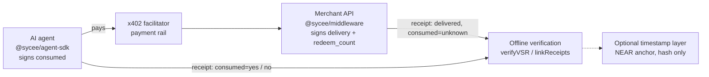

# SYCEE

[](https://github.com/ruiruii/sycee/actions/workflows/ci.yml)

**Others prove delivery. SYCEE proves consumption.**

An HTTP `200` means the bytes arrived. It does not mean the agent put them in a prompt,
passed them to a tool, or kept them at all. SYCEE records the difference, and counts how
many times one payment proof was redeemed.

`SYCEE` is a protocol-agnostic semantic layer for machine payments. It answers two
questions that x402 and the receipt formats around it do not yet define:

1. **Was the paid result actually consumed by downstream context?**
2. **How many times was the same payment proof redeemed?**

> We record. Others score. No custody, no fund movement, no reputation score.

---

## Quick start

Node.js 20 or newer. No wallet, no network, no accounts — the payment proof below is a
string, and SYCEE only ever handles its hash.

Just check a receipt, without cloning anything:

```bash
npx sycee-verify receipt.json          # or: npx sycee-verify --example
```

To work in the repository:

```bash
git clone https://github.com/ruiruii/sycee.git
cd sycee
npm install
npm run try                           # three receipts, one rule each — thirty seconds
npm test                              # 248 tests
npm run verify:py                     # the same 12 vectors, verified in Python
node examples/bilateral-consumption.mjs
```

`npm run try` needs no input. It hands three receipts to the checker and prints what each
one gets wrong:

```text
PASS  a repeat presentation that names the settlement it saw
      refused · duplicate_payment · settled · final · chain_verifiable

FAIL  a failed transfer whose transfer leg was never read
      leg_contradicts_reason
      transfer_leg_failed needs transfer = failed, the row records unknown
      refused · transfer_leg_failed · unknown · not final

FAIL  a pending settlement presented as final
      finality_pending_is_not_final
      settlement is pending, so the row cannot be final — the payment may
      still land
      refused · internal_error · pending · final

1/3 passed, 2 failed
```

Nothing was fetched, no key was consulted, no network was touched. The two failures are
what the format is for: a receipt whose reason and its own fields disagree is a receipt
saying something untrue, and the checker names the rule that broke rather than scoring it.

To run it on a receipt of your own — as a consumer (`npx`, no clone) or from a
checkout:

```bash
npx sycee-verify receipt.json                                  # no clone needed
node bin/sycee-verify.mjs receipt.json                         # from a checkout
node bin/sycee-verify.mjs --dir conformance/refusal/vectors    # 76/76
```

It takes a built row, a constructor input, or a conformance vector, and answers with the
same codes the vector set uses. `--json` returns the same verdicts for a pipeline.

The walkthrough buys the same search twice. One result is used, one is thrown away:

```text
WHAT THE SELLER RECORDED
  call 1  status=delivered  consumed=unknown  redeem_count=1
  call 2  status=delivered  consumed=unknown  redeem_count=1

WHAT THE BUYER RECORDED
  call 1  consumed=yes  consumed_by=["msg_4829"]
  call 2  consumed=no   consumed_by=[]
```

Two payments, two deliveries, two signed receipts — and the seller cannot tell them
apart. Only the buyer's runtime knows which result entered a prompt, and only the buyer
can sign that. **That signature is the product.**

The other half of the product is that the two ledgers can be put beside each other. The
buyer's entries and the seller's refusal rows share one identity (§3.1), so a dispute
comes back as `match` / `status_disagrees` / `only_buyer` / `only_seller` — never a
verdict. See [`examples/buyer-reconcile.mjs`](./examples/buyer-reconcile.mjs).

Other entry points: `npm run demo` (a payable server and a buyer in one process),
`npm run demo:bilateral` (buyer and seller ledgers reconciled per identity),
`npm run demo:refusal` (four refused attempts, each claim verified offline),
`node bin/sycee-doctor.mjs` (name the member a misconfigured proxy changed),
`npm run verify` (the signed conformance vectors).



Solid items are in this repository. The facilitator is the payment rail: SYCEE calls it,
never replaces it, and never touches funds. The anchor is optional — see
[`examples/near-anchor/`](./examples/near-anchor/).

---

## The gap

| Layer | Question it answers | State of the art | Missing |
|-------|--------------------|------------------|---------|
| x402, MPP, AP2 | How does the agent pay? | Standards and SDKs exist | — |
| x402-receipts, Vauban | Did payment happen, did the seller deliver? | Production code, IETF drafts | Consumption evidence |
| ERC-8183, VCAP | Did an evaluator judge the work complete? | Escrow / verdict layers | Non-custodial, non-scoring evidence |
| **SYCEE** | **Was the result consumed? How many redemptions?** | **This repo** | — |

An HTTP `200` does not tell you whether the agent:

- put the result in a prompt,
- passed it to another tool,
- stored it in working memory, or
- showed it to a user.

That gap is **idle spend**: money spent, bytes delivered, value never used. It is also the
gap where one `payment_proof` can be redeemed against several resources without anyone
noticing. SYCEE makes both observable.

## What SYCEE is not

- **Not a payment protocol.** It sits beside x402 (or any rail) and records what the rail
  cannot.
- **Not a receipt format competitor.** It adds two fields to formats that already exist.
- **Not a scoring system.** No trust scores, no credit, no blacklists.
- **Not a custodian.** No escrow, no fund movement, no balances.
- **Not an anchor product.** NEAR is one implementation of an optional timestamp layer.

---

## Conformance levels

| Level | Requires | Means |
|-------|----------|-------|
| **L0** | Emit `payment.proof_hash`, `delivery.status`, `result.consumed`, `payment.redeem_count` | Telemetry only |
| **L1** | L0 + a signed receipt from one side | Assertion, not attestation |
| **L2** | Two signed artifacts, one merchant and one agent, paired on the same `proof_hash` and `resource_id` | `consumed` attested; the level is the pair's verdict |

Two distinctions matter. First, a merchant can say `delivered`, and must say
`consumed: unknown` unless the result block is bilaterally co-signed; a merchant that signs
`consumed: yes` alone is claiming something it cannot observe. Second, **L2 is a verdict
about a pair, not a field**: a single envelope that writes `completeness: bilateral` still
verifies at L1, because the counterpart may not exist, may be unsigned, or may describe a
different attempt. `linkReceipts()` returns `level: 'L2'` only when both sides verify and
the roles differ.

```bash
npm run verify       # 12 signed vectors, expectations enforced
npm run verify:l0    # by level
npm run matrix       # all 12 verdicts as one page
```

[`conformance/vectors/matrix.svg`](./conformance/vectors/matrix.svg) prints each vector's
purpose, the checker's verdict, and the file's SHA-256, generated from `manifest.json`
rather than maintained by hand.

### Third reader

The §15 refusal vectors were read by an implementation that was not ours, written from the prose
alone with every guess logged before the run:

> [holistis/agent-receipt-verify](https://github.com/holistis/agent-receipt-verify),
> [`research/sycee-section-15-third-reader`](https://github.com/holistis/agent-receipt-verify/tree/main/research/sycee-section-15-third-reader),
> 2026-11-20, against `sycee@632c2f56`.

Against the 25 files that existed then, 21 agreed on the first run, and all eight wrong twins
differed from their right twin.
The four that do not agree are places where the text and the vectors disagree with each other —
recorded, not resolved — in [`conformance/refusal/README.md`](./conformance/refusal/README.md).

The part worth reading twice: the same report plants 21 plausible mistakes in a reader that
passes every file, and **15 of them still pass**. A vector set that cannot fail on a wrong
implementation is a vector set that has not been tested, and this is the only measurement of that
we have from outside.

## What is in this repo

```
SPEC.md                       normative specification v0.2
schema/vsr-v0.1.schema.json   JSON Schema for Verifiable Spend Receipts
conformance/vectors/          signed conformance vectors + matrix
packages/
  core/                       canonical JSON, Ed25519, VSR builder, offline verify
  middleware/                 merchant-side HTTP guard (challenge, redemptions, refusal rows)
  agent-sdk/                  agent-runtime SDK (composes identity, keeps refusals, co-signs)
  conformance/                validator and CLI
  adapter-automaton/          binds a hash-chained attestation ledger (RW-001)
  probe/                      evidence-layer CLI (probe / verify / batch)
python/                       second verifier (Ed25519 + canonical JSON), no JS imports, same author
examples/                     walkthroughs, bilateral demo, quickstart, demo merchant, NEAR anchor
upstream/                     ready-to-send proposals to x402-receipts, Vauban, ERC-8004
```

All packages are zero-dependency and use Node's native Ed25519.

## Integrating

**Merchant side.** `createGates` wraps a handler; it issues the 402 challenge, counts
redemptions per `proof_hash`, and attaches a signed receipt.

```js
import { createGates, memoryStore } from '@sycee/middleware';
import { generateKeyPair } from '@sycee/core';

const { publicKey, privateKey } = generateKeyPair();
const gates = createGates({
  resourceId: 'search.v1',
  protocol: 'x402',
  price: { value: '0.010000', currency: 'USDC' },
  payTo: '0x00000000000000000000000000000000000000bb',  // required: the identity is over it
  network: 'eip155:8453',
  scheme: 'exact',
  publicKey, privateKey,
  store: memoryStore(),          // or redisStore(client) in production
});

app.get('/search', gates.guard(async () => ({ status: 200, body: { ok: true } })));
```

**Agent side.** `createSpend` wraps `fetch`, captures the merchant receipt, and lets the
runtime state what happened to the result.

```js
import { createSpend } from '@sycee/agent-sdk';

const spend = createSpend({
  agentId: 'erc8004:8453:0xAGENT',
  publicKey, privateKey,
  pay: async () => 'payment-proof-bytes',   // your wallet logic
});

const res = await spend.fetch('https://api.example/search?q=ai');
const receipt = res.gates.consumedBy('task_4829');   // or .notConsumed()
```

**Verification.** Neither side needs the other, or the network:

```js
import { verifyVSR } from '@sycee/core';
const check = verifyVSR(envelope);   // { valid, level, errors, warnings }

import { linkReceipts } from '@sycee/agent-sdk';
linkReceipts(merchantEnvelope, agentEnvelope);   // { level: 'L2', completeness: 'bilateral', ... }
```

Wire-format headers keep the `x-gates-*` prefix and the receipt carries a `gates_spec`
field; both are compatibility names for already-integrated transports, not package names.

---

## Red lines

A conforming implementation **MUST NOT**:

1. Store or transport raw payment proof bodies.
2. Produce trust, credit, or reputation scores.
3. Move funds or act as an escrow.

These are structural, not policy. See [SPEC.md](./SPEC.md).

## Relationship to adjacent projects

SYCEE is additive, not competitive.

| Project | Defines | SYCEE adds |
|---------|---------|------------|
| **x402-receipts** (production) | Receipt format, request hash, delivery status, dual signature | `consumed` / `consumed_by` / `redeem_count`; multi-rail |
| **IETF draft-vauban-x402-*** | Receipt format, post-quantum signatures, Starknet anchoring | `consumed` / `redeem_count`; protocol-agnostic |
| **ERC-8183** | On-chain escrow, evaluator verdict | Off-chain, non-custodial consumption evidence |
| **VCAP / SwarmSync** | Escrowed settlement, delivery proof, reputation | Non-escrow, non-scoring |
| **ERC-8004** | Agent identity and payment-proof schema | Reserved fields for `consumed` / `redeem_count` |

## Upstream outreach

The objective is **one vocabulary, not a new project**. If another standard adopts these
field names, SYCEE adopts theirs.

| Target | Channel | Status |
|--------|---------|--------|
| x402-receipts (StelarDigital) | GitHub issue | [#6](https://github.com/StelarDigital/x402-receipts/issues/6) — converged; invariants internalized in SPEC §3.1 |
| ERC-8004 v2 | GitHub issue | [erc-8004-contracts#102](https://github.com/erc-8004/erc-8004-contracts/issues/102) — open |
| Vauban Research (IETF) | GitHub issue | [x402-stark-receipts-conformance#3](https://github.com/vauban-org/x402-stark-receipts-conformance/issues/3) — open |
| Predge | GitHub issue | [erc8004-outcome-validator#13](https://github.com/predgeAI/erc8004-outcome-validator/issues/13) — open |
| Brave `bx402` | GitHub issue | [bx402#141](https://github.com/brave/bx402/issues/141) — open |

Draft proposals and the field notes from that outreach are in
[`upstream/`](./upstream). One deadline is worth naming: Vauban's
`draft-vauban-x402-stark-receipts` expires **2026-11-26**, so the `consumed` semantic
needs at least one adopter published before then, or the adjacent field gets defined first
by someone else.

What other implementations actually do — read at a dated commit, quoted with line numbers,
including the ones that reflect badly on nobody and the one that does — is in
[`docs/observations.md`](./docs/observations.md).

## Hosted evidence service

The packages here are free and Apache-2.0. A separate hosted service would keep a
third-party copy of already-signed receipts and run anchors on request. It is in pilot,
is **not** built in this repository, and takes no custody. What is open, what is
commercial, and what the pilot covers: [docs/hosted-service.md](./docs/hosted-service.md).

## Roadmap

| Phase | Goal | Status |
|-------|------|--------|
| 1 | Publish repo + SPEC v0.1 | done |
| 2 | Field alignment to x402-receipts, Vauban, ERC-8004 | done, threads open |
| 3 | First independent implementation adopts `consumed` / `redeem_count` | open |
| 4 | Merchant + agent SDK against a live seller (Brave / bx402) | open |
| 5 | Cross-rail support (APOP, alipay-a2m, a2p2) | open |

## Name

Published as `gates-spec` through v0.1, now `SYCEE`. Old receipts signed under
`gates-spec/v0.1` stay valid; the twelve vectors were regenerated because the version
string is an input to each fingerprint. Package names moved from `@gates-spec/*` to
`@sycee/*`. [`gates-spec-migrated`](https://github.com/ruiruii/gates-spec-migrated) points
here.

## Contributing

See [CONTRIBUTING.md](./CONTRIBUTING.md). The two things most needed are independent
implementations in another language and upstream alignment.

## License

Apache-2.0. See [LICENSE](./LICENSE).

---

<sub>Hackathon submission material (NEAR, October 2026) is preserved verbatim at
[docs/hackathon.md](./docs/hackathon.md). Chinese README:
[README.zh.md](./README.zh.md). Component design:
[docs/ARCHITECTURE.md](./docs/ARCHITECTURE.md).</sub>
