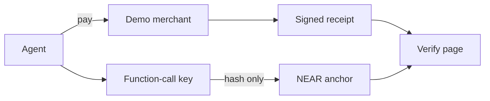

# SYCEE receipt fingerprints on NEAR

A page you can open, with no wallet:

- Local file: [examples/near-anchor/demo/index.html](demo/index.html)
- Public URL: [https://ruiruii.github.io/sycee/](https://ruiruii.github.io/sycee/) (deployed from main, HTTP 200). The same file is [demo/index.html](demo/index.html).
- Live check. `tx` must be the full nearblocks URL: [open the recorded testnet receipt](https://ruiruii.github.io/sycee/?hash=sha256:618a391577ebd1e6a94430f05947e74c84a7d59523034ed28851b712a40ead81&offline=0&tx=https%3A%2F%2Ftestnet.nearblocks.io%2Ftxns%2F6TyCsHwSkwKshGgWGDJPFqrW2WLqrBnpvw3Amy4ppxTo). The published page reads `hash`, `offline`, and that full `tx` URL.

This is the English text of [SUBMISSION.zh.md](SUBMISSION.zh.md). The owner's checklist is [提交清单.md](提交清单.md).

## Problem

An agent pays for a call on a person's behalf (agent payment). After the payment, how can someone else tell that the receipt was not edited?

SYCEE already issues a verifiable receipt. The demo merchant, on Base Sepolia, sells one test call, `GET /v1/base/tip`, for 0.001 test USDC. When the payment is accepted, the merchant signs a receipt. The receipt holds hashes and a signature. It does not hold the payment itself.

What was missing is a public time record: this receipt's fingerprint was written down at a known moment. This project does not score anyone, does not hold funds, and does not move funds.

## Solution

The receipt is still produced by the demo merchant on Base Sepolia. This project copies the receipt's fingerprint onto NEAR. That copy is the cross-chain anchoring step: one chain produces the receipt, the other stamps the fingerprint with a block time.

The fingerprint uses the same algorithm SYCEE already uses. The receipt is turned into one canonical JSON text, then SHA-256. For the sample receipt in this repo, that value is:

`sha256:f296fd15aee336c3d877dab40eec7a6e64f68923d4002807a2433866ab69cf03`

That sample is not a payment that happened. The demo page recomputes it with the same algorithm and can match this string with no network.

The contract stores the fingerprint, the source chain (for example `eip155:84532`), the merchant's public payTo address, the block height, the time, and which account wrote it. It does not store the receipt body, the payment proof, or personal data.

Who may write is fixed at deploy. Everyone else can only read. The same fingerprint cannot be written twice.

## What we built on NEAR

The contract is in `contract/`. It does not accept NEAR and it does not send NEAR. In plain language the methods are:

- `new`: at deploy, sets the owner and any other accounts allowed to write. Called once.
- `anchor`: writes one receipt fingerprint. A repeat is rejected. An account that is not on the list is rejected.
- `anchor_batch`: writes up to 32 fingerprints and computes one combined fingerprint (a Merkle root). The contract computes that root. The caller does not get to invent it.
- `get_anchor`: looks up one fingerprint. Returns empty when it was never written.
- `is_anchored`: whether that fingerprint is stored.
- `get_batch`: looks up one combined fingerprint.
- `verify_inclusion`: given one fingerprint and a short proof, checks that it belongs to that combined fingerprint and that this contract stored the batch.
- `add_anchorer` / `remove_anchorer`: the owner adds or removes a writer. The owner cannot be removed.
- `get_owner` / `is_anchorer`: read the owner and the writer list. Anyone can read.

Each write emits a public log in the NEP-297 shape. The log is fingerprints and labels only.

Checking happens in two places. The browser page only recomputes the fingerprint. The Node script `scripts/verify.mjs` also checks the SYCEE signature, then compares the fingerprint on chain. The chain does not check the signature, does not decide whether the payment succeeded, and does not decide whether the buyer used the result.

## Results

These ran on this machine. They are not a plan.

- The contract builds. `bash scripts/build.sh` writes a wasm of **159146 bytes** (`out/sycee_anchor.wasm`).
- 6 Rust unit tests passed (`cargo +1.100.0 test`): write, duplicate rejected, stranger rejected, attached deposit rejected, the owner allows another writer, and the batch fingerprint matches the off-chain check.
- 16 Node unit tests passed: the fingerprint matches `@sycee/core`, the combined fingerprint, the demo page's algorithm, and the deploy script's refusal of mainnet.
- 3 local NEAR sandbox tests passed. They cover the contract sandbox (write, duplicate rejected, stranger rejected, a missing fingerprint reads back empty, attached NEAR rejected, the public log, a batch root equal to the JavaScript root, `verify_inclusion`, and `scripts/verify.mjs` against that local chain), the end-to-end demo, and the restricted-key demo.
- The demo page opens with a sample receipt filled in. With "离线示例" checked, it computes `sha256:f296fd15aee336c3d877dab40eec7a6e64f68923d4002807a2433866ab69cf03` and shows that this matches the fingerprint written into the page. That step does not contact testnet.
- The testnet contract is deployed. Account `sycee-anchor.testnet`, owner `sycee-anchor.testnet`, anchorers `[]`. Built from commit `01b4e419`, wasm 159146 bytes, sha256 `c027e046864760b51848501cec91c5c0b4e738d6dc94de86ce63d3d0ae98a236`. Deploy transaction: [J14QkoAmZmtNeFrUcjb5BwN1WjhoN4L7QwiQ9YF5zq3h](https://testnet.nearblocks.io/txns/J14QkoAmZmtNeFrUcjb5BwN1WjhoN4L7QwiQ9YF5zq3h).
- That same sample receipt (`fixtures/sample-receipt.json`) is anchored. Hash `sha256:f296fd15aee336c3d877dab40eec7a6e64f68923d4002807a2433866ab69cf03`, source chain `eip155:84532`, merchant id `sycee:demo-merchant`, block 277456711. Anchor transaction: [9WbMG7rgCiX7TNhnhZdSwGvz2xv82HX3oCgbVCdQHxzJ](https://testnet.nearblocks.io/txns/9WbMG7rgCiX7TNhnhZdSwGvz2xv82HX3oCgbVCdQHxzJ). `verify.mjs` returned ok.

## What was built during the hackathon

SYCEE's specification and signing code already existed before 2026-10-19. The last commit before that day is [`f1af69d`](https://github.com/ruiruii/sycee/commit/f1af69de1f461d9d656f598473042187e9118db1) (2026-10-12). The new work is `examples/near-anchor/`: the contract, the demo page, the end-to-end demo, and the restricted-key demo.

Compare: https://github.com/ruiruii/sycee/compare/f1af69de1f461d9d656f598473042187e9118db1...main

That diff also contains other SYCEE commits that landed on main after 19 October, including the demo merchant. The owner will add the tags `pre-hackathon` and `hackathon-submission`. This change does not create tags.

## Libraries, templates and AI-generated code

`near-sdk` 5.7.1 builds the contract. `near-workspaces` and `near-sandbox` (nearcore 2.6.2) run the local chain. `near-api-js` 5 signs transactions. `near-cli-rs` is the command a person uses to deploy. `wasm-opt` rewrites the wasm so the sandbox can load it. `@sycee/core` and the demo merchant are existing SYCEE code. Most of `examples/near-anchor/` was written with Cursor AI coding agents and reviewed by the team.

## 3-step try it

From anywhere inside the clone. Node.js 20 or newer, and rustup. `scripts/build.sh` installs Rust 1.86.0. No NEAR account. The root `npm install` has to come first, because the demo merchant imports the workspace packages.

```bash
cd "$(git rev-parse --show-toplevel)"
npm install
cd examples/near-anchor
npm install
bash scripts/build.sh
```

You see `159146` on the last line.

```bash
cd "$(git rev-parse --show-toplevel)/examples/near-anchor"
npm run demo:e2e
```

You see `payment: SIMULATED`, `http_status: 200`, `receipt_hash: sha256:` plus 64 hex characters, `chain: local NEAR sandbox`, `verify: ok true`, and `nearblocks: n/a`. No real transfer.

```bash
cd "$(git rev-parse --show-toplevel)/examples/near-anchor"
NEAR_CONTRACT_ID=sycee-anchor.testnet node scripts/verify.mjs --receipt fixtures/sample-receipt.json
```

You see `"ok": true`. This only reads the sample receipt already stored on testnet.

The demo page accepts the `receipt_hash` line, or `demo/index.html?hash=sha256:...&tx=https://testnet.nearblocks.io/txns/...&offline=0`.

Optional. Skip this unless you already have the NEAR account. The key is not printed.

```bash
cd "$(git rev-parse --show-toplevel)/examples/near-anchor"
NEAR_ACCOUNT_ID=sycee-anchor.testnet NEAR_CONTRACT_ID=sycee-anchor.testnet npm run demo:e2e -- --testnet
```

You see `chain: NEAR testnet` and a `nearblocks:` link. The demo page URL includes `&tx=`.

Recorded run: [6TyCsHwSkwKshGgWGDJPFqrW2WLqrBnpvw3Amy4ppxTo](https://testnet.nearblocks.io/txns/6TyCsHwSkwKshGgWGDJPFqrW2WLqrBnpvw3Amy4ppxTo). The receipt hash starts with `sha256:618a3915`. The payment was simulated.

```bash
cd "$(git rev-parse --show-toplevel)/examples/near-anchor"
npm run demo:security
```

You see `anchor_with_limited_key: ok`, `transfer NEAR: rejected`, and `add key: rejected`. The key may call only `anchor` and `anchor_batch` on this contract. It cannot transfer NEAR or add a key.

Optional. Skip this unless you already have the NEAR account. It adds one restricted key and spends testnet gas only:

```bash
cd "$(git rev-parse --show-toplevel)/examples/near-anchor"
NEAR_ACCOUNT_ID=sycee-anchor.testnet NEAR_CONTRACT_ID=sycee-anchor.testnet npm run demo:security -- --testnet
```

Recorded run. Restricted public key `ed25519:7G1L5eMc5pKCJcVNbHvv68j1THA6bxc9QDFg7sFN4Qjy`. Added in [HpZaM37gDbngx7skC1vjk81QFkjb7Yv2jLHN7GGWSLnh](https://testnet.nearblocks.io/txns/HpZaM37gDbngx7skC1vjk81QFkjb7Yv2jLHN7GGWSLnh). Anchor with that key: [9u6vfDWwuMdUcyVb3LXDUuotbdQBF68EmbX7Z6oRM8r6](https://testnet.nearblocks.io/txns/9u6vfDWwuMdUcyVb3LXDUuotbdQBF68EmbX7Z6oRM8r6). Duplicate rejected by the contract: [234ghPupTc158iY6osT53vBTML823BrGYLgdeNg4dPM6](https://testnet.nearblocks.io/txns/234ghPupTc158iY6osT53vBTML823BrGYLgdeNg4dPM6). Transfer, adding a key, and `add_anchorer` were rejected at access-key validation and may not appear on an explorer.



| Judging area | What we did | Evidence |
|---|---|---|
| Technical implementation | One command runs pay, receipt, anchor, and verify | `npm run demo:e2e` |
| Design | Hashes only | `contract/src/lib.rs` |
| Impact | The sample receipt is on testnet | [anchor tx](https://testnet.nearblocks.io/txns/9WbMG7rgCiX7TNhnhZdSwGvz2xv82HX3oCgbVCdQHxzJ) |
| Originality | Code before 19 October is the baseline | [compare](https://github.com/ruiruii/sycee/compare/f1af69de1f461d9d656f598473042187e9118db1...main) |
| Sustainability | The agent key cannot move funds | `npm run demo:security` |

The owner posted these. Nothing is posted from here.

- Demo video: [https://x.com/aking_z/status/2121175474265313681](https://x.com/aking_z/status/2121175474265313681) (2-min, posted as a reply under the demo post).
- Demo post on X: [https://x.com/aking_z/status/2121175201778143394](https://x.com/aking_z/status/2121175201778143394).

Still the owner's, not done here:

- Mainnet payout account: `locallemon5213.near`. The owner created it and it was verified on mainnet. Nothing in this repository is deployed to mainnet, and nothing here moves funds.
- Public demo URL: [https://ruiruii.github.io/sycee/](https://ruiruii.github.io/sycee/). The published page reads `hash`, `offline`, and a full nearblocks `tx` URL.
