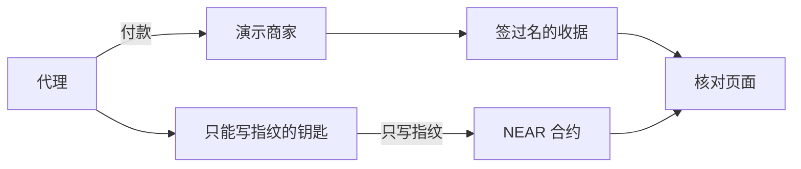

SYCEE 是 AI agent 支付的证据层，每笔支付都有一张签名收据，指纹记在 NEAR 上，任何人都能核实，而且 SYCEE 从不碰资金。

# SYCEE 在 NEAR 上留收据指纹

演示页面，打开就能看，不需要钱包：

- 本地文件：[examples/near-anchor/demo/index.html](demo/index.html)
- 公开网址：[https://ruiruii.github.io/sycee/](https://ruiruii.github.io/sycee/)（已从 main 部署，打开返回 200）。本地文件仍是 [demo/index.html](demo/index.html)。
- 带参数的核对链接（`tx` 要写成完整的 nearblocks 网址）：[打开这次测试网收据](https://ruiruii.github.io/sycee/?hash=sha256:618a391577ebd1e6a94430f05947e74c84a7d59523034ed28851b712a40ead81&offline=0&tx=https%3A%2F%2Ftestnet.nearblocks.io%2Ftxns%2F6TyCsHwSkwKshGgWGDJPFqrW2WLqrBnpvw3Amy4ppxTo)。线上页面会读取 `hash`、`offline` 和完整的 `tx`。

英文稿在 [SUBMISSION.en.md](SUBMISSION.en.md)。给主人勾的清单在 [提交清单.md](提交清单.md)。

## 问题

机器帮人付钱（agent payment）。付完之后，旁人怎么知道那张收据没有被改过？

SYCEE 已经会开一张能核对的收据（verifiable receipt）。演示商家在 Base Sepolia（以太坊的一条测试网）上卖一个测试接口，`GET /v1/base/tip`，价格是 0.001 美元的测试 USDC。付款成功后，商家签一张收据。收据里只有指纹和签名，没有付款原文。

缺的是一个谁都能查的时间记录：这张收据的指纹，在某个时刻被人写下了。我们不给人打分，不保管钱，也不替任何人转账。

## 方案

收据还是在 Base Sepolia 的演示商家那边产生。我们只做一件事：把收据的指纹抄到 NEAR 测试网上。这叫跨链留痕（cross-chain anchoring）。一边出收据，另一边给指纹盖一个带时间的章。

指纹的算法和 SYCEE 自己用的一样。把收据整理成固定格式的 JSON，再做 SHA-256。带前缀写出来是：

`sha256:f296fd15aee336c3d877dab40eec7a6e64f68923d4002807a2433866ab69cf03`

这是仓库里那张示例收据的指纹，不是一笔已经发生的付款。演示页用同一套算法重算，离线就能对上这串字。

合约里只存指纹、来源链（例如 `eip155:84532`）、商家公开的收款地址、区块高度、时间、以及是谁写进去的。不存收据正文，不存付款原文，不存私人信息。

谁可以写，在部署时定好。其他人只能查。同一条指纹不能写第二次。

## NEAR 上做了什么

合约在 `contract/`。它不收 NEAR，也不转出 NEAR。方法用白话说是这些：

- `new`：部署时设定主人，以及还可以让谁写入。只在一开始用一次。
- `anchor`：写下一条收据指纹。重复的会被拒绝。不在名单上的人会被拒绝。
- `anchor_batch`：一次写下最多 32 条，并算出一个总指纹（把许多指纹再合成一个，英文叫 Merkle root）。总指纹由合约自己算，调用的人不能随便填。
- `get_anchor`：按指纹查询。没有就返回空。
- `is_anchored`：这条指纹在不在。
- `get_batch`：查询某一次批量的总指纹。
- `verify_inclusion`：拿一条指纹和一份对照材料，检查它是不是属于那个总指纹，并且这个合约确实记过那一批。
- `add_anchorer` / `remove_anchorer`：主人增减可以写入的账号。主人自己不能被删掉。
- `get_owner` / `is_anchorer`：查看主人和名单。谁都可以看。

每次写入会打一条公开日志（NEP-297 这种格式）。日志里也只有指纹和标签。

核对分两处。浏览器演示页只重算指纹。Node 脚本 `scripts/verify.mjs` 还会用 SYCEE 的签名检查，再去链上对指纹。链本身不检查签名，也不判断这笔钱付没付成，也不判断买方用没用过结果。

## 结果

下面这些是已经在这台机器上跑过的，不是计划。

- 合约能编译。`bash scripts/build.sh` 得到的 wasm 是 **159146 字节**（`out/sycee_anchor.wasm`）。
- Rust 单元测试 6 个通过（`cargo +1.100.0 test`）：写入、重复拒绝、外人拒绝、拒收转账、主人授权另一个账号、批量总指纹和对照。
- Node 单元测试 16 个通过：指纹和 `@sycee/core` 一致、总指纹、演示页算法、部署脚本拒绝主网。
- 本地 NEAR 沙箱测试 3 个通过。它们覆盖合约沙箱（写入、重复拒绝、外人拒绝、查不到时返回空、拒收附带的 NEAR、公开日志、批量总指纹和 JavaScript 算的一致、`verify_inclusion`、以及 `scripts/verify.mjs` 对着这个本地链核对成功）、端到端演示和受限钥匙演示。
- 演示页打开就有一张示例收据。勾着「离线示例」时，它算出 `sha256:f296fd15aee336c3d877dab40eec7a6e64f68923d4002807a2433866ab69cf03`，并显示和页内写死的指纹一致。这一步没有连测试网。
- 测试网合约已经部署。账号 `sycee-anchor.testnet`，主人也是这个账号，写入名单是空的。来自提交 `01b4e419`，wasm 159146 字节，sha256 `c027e046864760b51848501cec91c5c0b4e738d6dc94de86ce63d3d0ae98a236`。部署交易：[J14QkoAmZmtNeFrUcjb5BwN1WjhoN4L7QwiQ9YF5zq3h](https://testnet.nearblocks.io/txns/J14QkoAmZmtNeFrUcjb5BwN1WjhoN4L7QwiQ9YF5zq3h)。
- 同一张示例收据（`fixtures/sample-receipt.json`）已经写上链。指纹就是上面那串，来源链 `eip155:84532`，商家 `sycee:demo-merchant`，区块 277456711。锚定交易：[9WbMG7rgCiX7TNhnhZdSwGvz2xv82HX3oCgbVCdQHxzJ](https://testnet.nearblocks.io/txns/9WbMG7rgCiX7TNhnhZdSwGvz2xv82HX3oCgbVCdQHxzJ)。`verify.mjs` 返回成功。

## 这次黑客松做了什么

SYCEE 的规格和签名代码在 2026-10-19 之前就有了。那天之前最后一次提交是 [`f1af69d`](https://github.com/ruiruii/sycee/commit/f1af69de1f461d9d656f598473042187e9118db1)（2026-10-12）。这次新做的是 `examples/near-anchor/`：合约、演示页、端到端演示、受限钥匙演示。

对照：https://github.com/ruiruii/sycee/compare/f1af69de1f461d9d656f598473042187e9118db1...main

对照里也有 10 月 19 日之后合进 main 的其他改动，包括演示商家。标签 `pre-hackathon` 和 `hackathon-submission` 由主人自己加。

## 用了哪些现成的东西，哪些是 AI 写的

`near-sdk` 5.7.1 写合约。`near-workspaces` 和 `near-sandbox`（nearcore 2.6.2）做本地链。`near-api-js` 5 用来签名发交易。`near-cli-rs` 是人部署时用的命令行。`wasm-opt` 把 wasm 收成沙箱能读的格式。`@sycee/core` 和演示商家是原来就有的 SYCEE 代码。`examples/near-anchor/` 里的大部分代码是用 Cursor 的 AI 编程助手写的，再由团队看过。

## 三步试一下

在克隆下来的仓库里任意目录都能跑。需要 Node.js 20 或更新版本，以及 rustup。`scripts/build.sh` 会安装 Rust 1.86.0。不需要 NEAR 账号。要先在仓库根目录 `npm install`，因为演示商家会引用工作区里的包。

```bash
cd "$(git rev-parse --show-toplevel)"
npm install
cd examples/near-anchor
npm install
bash scripts/build.sh
```

你看到最后一行字节数 `159146`。

```bash
cd "$(git rev-parse --show-toplevel)/examples/near-anchor"
npm run demo:e2e
```

你看到 `payment: SIMULATED`，`http_status: 200`，`receipt_hash: sha256:` 加 64 位，`chain: local NEAR sandbox`，`verify: ok true`，`nearblocks: n/a`。这是模拟付款，没有真的转账。

```bash
cd "$(git rev-parse --show-toplevel)/examples/near-anchor"
NEAR_CONTRACT_ID=sycee-anchor.testnet node scripts/verify.mjs --receipt fixtures/sample-receipt.json
```

你看到 `"ok": true`。这是只读核对已经写在测试网上的示例收据。

演示页可以贴 `receipt_hash` 那一行，或打开 `demo/index.html?hash=sha256:...&tx=https://testnet.nearblocks.io/txns/...&offline=0`。

可选。没有你自己的 NEAR 账号就跳过。钥匙不打印。

```bash
cd "$(git rev-parse --show-toplevel)/examples/near-anchor"
NEAR_ACCOUNT_ID=sycee-anchor.testnet NEAR_CONTRACT_ID=sycee-anchor.testnet npm run demo:e2e -- --testnet
```

你看到 `chain: NEAR testnet` 和 `nearblocks: https://testnet.nearblocks.io/txns/` 开头的链接。演示页地址带 `&tx=`。

已经跑通的一笔：[6TyCsHwSkwKshGgWGDJPFqrW2WLqrBnpvw3Amy4ppxTo](https://testnet.nearblocks.io/txns/6TyCsHwSkwKshGgWGDJPFqrW2WLqrBnpvw3Amy4ppxTo)，收据指纹以 `sha256:618a3915` 开头。付款是模拟的。

```bash
cd "$(git rev-parse --show-toplevel)/examples/near-anchor"
npm run demo:security
```

你看到 `anchor_with_limited_key: ok`，以及 `transfer NEAR: rejected`、`add key: rejected`。这把钥匙只能对这个合约调用 `anchor` 和 `anchor_batch`，不能转账，不能加钥匙。

可选。没有你自己的 NEAR 账号就跳过。会加一把受限钥匙，只花测试网手续费：

```bash
cd "$(git rev-parse --show-toplevel)/examples/near-anchor"
NEAR_ACCOUNT_ID=sycee-anchor.testnet NEAR_CONTRACT_ID=sycee-anchor.testnet npm run demo:security -- --testnet
```

已经跑通。受限公钥 `ed25519:7G1L5eMc5pKCJcVNbHvv68j1THA6bxc9QDFg7sFN4Qjy`。加钥匙：[HpZaM37gDbngx7skC1vjk81QFkjb7Yv2jLHN7GGWSLnh](https://testnet.nearblocks.io/txns/HpZaM37gDbngx7skC1vjk81QFkjb7Yv2jLHN7GGWSLnh)。用这把钥匙写入：[9u6vfDWwuMdUcyVb3LXDUuotbdQBF68EmbX7Z6oRM8r6](https://testnet.nearblocks.io/txns/9u6vfDWwuMdUcyVb3LXDUuotbdQBF68EmbX7Z6oRM8r6)。重复写入被拒绝：[234ghPupTc158iY6osT53vBTML823BrGYLgdeNg4dPM6](https://testnet.nearblocks.io/txns/234ghPupTc158iY6osT53vBTML823BrGYLgdeNg4dPM6)。转账、再加钥匙、调用 `add_anchorer` 在钥匙校验时就被拒绝，浏览器上不一定看得到。



| 评审看什么 | 我们做了什么 | 证据 |
|---|---|---|
| 技术能不能跑 | 一条命令走完付款、收据、锚定、核对 | `npm run demo:e2e` |
| 设计 | 只存指纹 | `contract/src/lib.rs` |
| 有没有用 | 测试网上查得到示例收据 | [锚定交易](https://testnet.nearblocks.io/txns/9WbMG7rgCiX7TNhnhZdSwGvz2xv82HX3oCgbVCdQHxzJ) |
| 是不是新做的 | 10 月 19 日前是旧代码 | [对照](https://github.com/ruiruii/sycee/compare/f1af69de1f461d9d656f598473042187e9118db1...main) |
| 能不能接着用 | 代理钥匙不能转账 | `npm run demo:security` |

主人已经发了。这里不发帖。

- 演示视频：[https://x.com/aking_z/status/2121175474265313681](https://x.com/aking_z/status/2121175474265313681)（2 分钟，发在演示帖下面的回复里）。
- X 上的演示帖：[https://x.com/aking_z/status/2121175201778143394](https://x.com/aking_z/status/2121175201778143394)。

还没做、要主人自己做的：

- 主网收款账号：`locallemon5213.near`。主人已在主网建好，并核对过。这里不部署到主网，也不转账。
- 公开演示网址已经是 [https://ruiruii.github.io/sycee/](https://ruiruii.github.io/sycee/)。线上页面会读取 `hash`、`offline` 和完整的 nearblocks `tx`。
